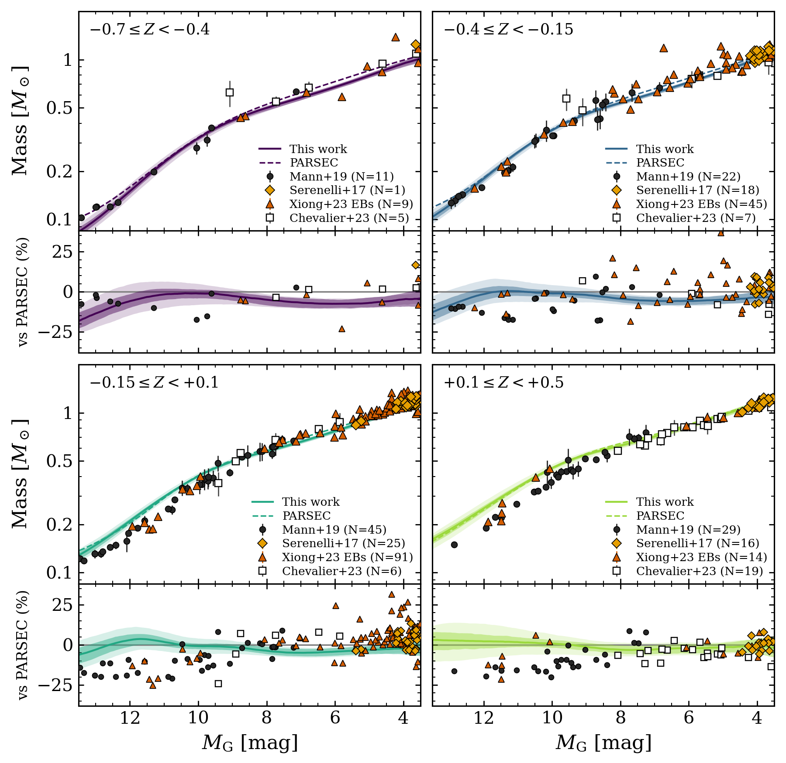

# wbmlr: a dynamical mass–luminosity relation from Gaia wide binaries

Mass of a single main-sequence star as a function of its Gaia absolute magnitude $M_G$ and metallicity $Z$,
calibrated dynamically with 10,559 wide binaries (Wang, Rix, Li & Ting, in prep.). The mass scale comes from the
relative motion of the two stars, not from stellar evolution models.

- Domain: $3.5 \le M_G \le 13.5$ mag, $-1.0 \le Z \le 0.6$ dex (NaN outside).
- Data region: $3.7 \lesssim M_G \lesssim 11.8$, $-0.5 \lesssim Z \lesssim 0.4$. Outside it the relation is set by
  monotonicity and priors, not by the data; `in_data_region` flags it.
- Statistical uncertainty where the data are: 1.9–4.7 % in mass (median 2.5 %).



*The relation in four bins of the calibrated metallicity $Z$ (from the paper). Upper panels: mass against $M_G$;
lower panels: difference from PARSEC at the same $Z$. Solid line and bands: this work (68 and 95 % credible
intervals); dashed line: PARSEC. Symbols are independent literature masses (Mann et al. 2019, Serenelli et al. 2017,
Xiong et al. 2023, Chevalier et al. 2023), shown on their own metallicity scales.*

## Install and use

```bash
pip install .            # numpy and scipy only
```

Most users know a star's absolute magnitude and colour, not its metallicity, so the main entry point is the
colour–magnitude diagram. In the paper, the fit gives the mass as a function of $(M_G, Z)$. At a position of the diagram the
wide-binary components of our sample have a distribution of calibrated metallicities $p(Z\mid M_G,\text{BP-RP})$, and
the mass returned for that position is the posterior mass marginalised over it,
$p(M\mid M_G,\text{BP-RP})=\int p(M\mid M_G,Z)\,p(Z\mid M_G,\text{BP-RP})\,dZ$:

```python
import numpy as np
from wbmlr import MLR

mlr = MLR()
mg = np.array([5.0, 8.0, 11.0])                  # absolute G magnitude
bp_rp = np.array([0.87, 1.75, 2.70])             # intrinsic (dereddened) BP-RP
lo, med, hi = mlr.mass_from_cmd(mg, bp_rp)       # 16, 50, 84 per cent, in Msun
z, z_std = mlr.z_from_color(mg, bp_rp, return_std=True)
```

The quantiles therefore include the fit uncertainty and the spread of metallicities at that position (`z_std`,
typically 0.1–0.15 dex). `z_from_color` returns the mean $Z$ and its standard deviation; `mass_from_cmd(...,
marginalize=False)` evaluates the mass at the mean $Z$ only. Positions with fewer than about 20 effective sample
stars return NaN. If you have your own metallicity:

```python
mlr.mass(7.0, -0.2)                              # median mass for M_G and Z
mlr.mass_quantiles(mg, 0.0)                      # 16, 50, 84 per cent
mlr.in_data_region(mg, 0.0)                      # True where the fit is constrained by the data
draws = mlr.mass_draws(mg, 0.0)                  # (4000, 3) posterior draws
total = draws.sum(axis=1)                        # correlated errors propagate correctly
```

Functions take arrays of any shape (broadcast against each other). See `examples/example.py`.

If you prefer a table, interpolate `src/wbmlr/data/mlr_cmd_grid.csv` on $(M_G, \text{BP-RP})$.

## Metallicity

`Z` is the calibrated metallicity $Z_j$ of the sample on a scale anchored to the Sun (the PARSEC [M/H] scale). The
colour-based `Z` is the average $Z_j$ of the sample components in a window of 0.05 mag in $M_G$ and 0.02 mag in
colour around the position, so it describes the population of our sample (single main-sequence stars in
wide binaries within 1 kpc of the Sun). Because the colour is only a weak metallicity indicator compared with its
scatter, `Z` varies slowly with colour, and `z_std` is large. For stars of a different population, such as clusters or
the halo, a metallicity from spectroscopy is preferable. The mass depends on $Z$ much less than on $M_G$.

## Data files (`src/wbmlr/data`)

| File | Content |
|---|---|
| `mlr_cmd_grid.csv` | Table on the colour–magnitude diagram: `MG` (step 0.05), intrinsic `BP_RP` (step 0.01), the mean `Z_mean` and standard deviation `Z_std` of the calibrated metallicity of the sample stars there, their effective number `n_eff` ($\ge20$), the marginalised `mass_p16/p50/p84` (Msun), `mass_p50_at_Z_mean` (median mass at `Z_mean` alone), and `in_data_region` (0/1) |
| `mlr_grid.csv` | Table on a $0.05$ mag $\times$ $0.05$ dex $(M_G, Z)$ grid: `MG, Z, mass_p16, mass_p50, mass_p84` (Msun), `mass_parsec`, `delta_parsec_percent` (median relative to PARSEC at the same $Z$), `in_data_region`, and the mean `bp_rp_mean`, scatter `bp_rp_std` and effective number `n_eff` of the intrinsic BP-RP of the sample stars with that $Z$ and $M_G$ (NaN where fewer than 20) |
| `mlr_theta_draws.npz` | 4000 posterior draws of the $8\times4$ B-spline coefficients `theta` of $\log_{10}(M/M_\odot)$, plus `knots_x`, `knots_z`, degrees. $g(M_G,Z)=\sum_{ih}\theta_{ih}B_i(M_G)C_h(Z)$, cubic, clamped knots |
| `cmd_empirical.npz` | The arrays behind `mlr_cmd_grid.csv` and the functions: mean and standard deviation of $Z$, effective number, and the distribution `p_z` of $Z$ over the nodes `z_nodes` at each position |
| `data_coverage.npz` | Smoothed density of the sample components in $(M_G, Z)$ and the level enclosing 95 % of them |
| `meta.json` | Provenance |

## What the uncertainties contain

The quantiles are statistical, from the posterior of the adopted fit (eccentricity index $\alpha_e=1.233$; an
outlier component for pairs with a hidden close companion, whose shape and fraction for each pair follow a forward model
of such companions; selection $3\sigma_u<u<U_j$ including the bound-orbit limit of the catalogue). Further systematic
effects (see the paper): fitting only the pairs with $u/\sigma_u>10$ raises the masses by up to 5 % at $M_G\le8$ and
makes the metallicity dependence steeper by up to 0.03 in $\Delta\log_{10}M/\Delta Z$; the eccentricity distribution
changes the masses by up to 2 %. At $M_G>10.5$ the individual dynamical masses in the literature lie about 17 % below
this relation.

The relation describes single main-sequence stars. It does not apply to unresolved binaries, pre-main-sequence
stars or evolved stars.

## Tests

```bash
pip install ".[test]" && pytest
```

## Citation

Wang, Rix, Li & Ting (in prep.), *Dynamical calibration of a metallicity-dependent stellar mass–luminosity relation
from Gaia wide binaries*. 
The files in `src/wbmlr/data` were produced from the analysis repository by `scripts/export_public_mlr.py`
(https://github.com/yt-wangg/Dynamical-masses).
